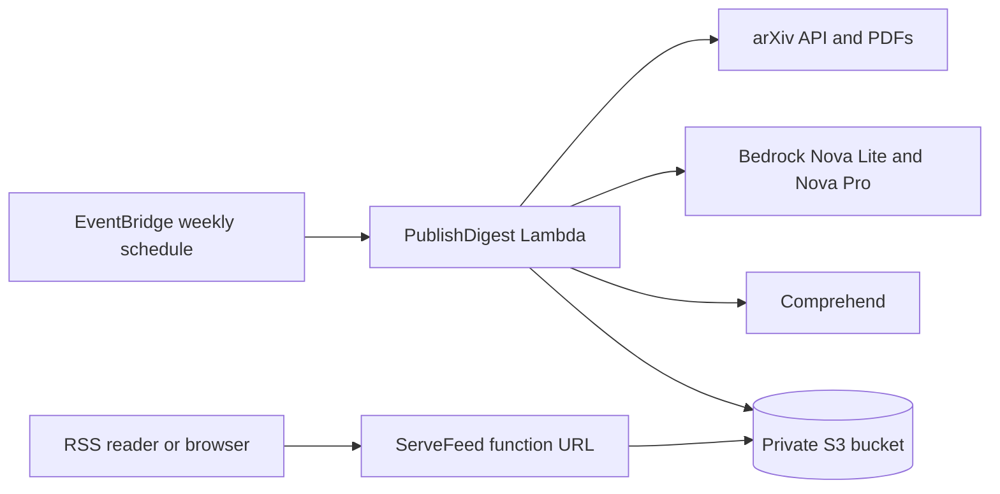

# AI Paper News

A weekly RSS digest of new AI papers from [arXiv](https://arxiv.org). Once a week, a Lambda function reads every new paper in `cs.AI`, `cs.LG`, `cs.CL`, `cs.CV`, and `stat.ML`, downloads the 30 most promising, and publishes a digest of the 10 that matter most, with a plain-language summary of each. Amazon Bedrock does the scoring, ranking, and writing. Amazon Comprehend adds a tone line for each paper.

The feed is a private S3 object. A second Lambda function serves it at a public HTTPS function URL, along with an HTML page for each week. There is no database, API Gateway, CloudFront, or VPC, and a week costs about a dollar.



- [What a run does](#what-a-run-does)
- [Cost](#cost)
- [Install](#install)
- [Deploy](#deploy)
- [Use the feed](#use-the-feed)
- [Run, check, and redo a week](#run-check-and-redo-a-week)
- [Change settings](#change-settings)
- [Troubleshooting](#troubleshooting)
- [Remove the stack](#remove-the-stack)
- [Project layout](#project-layout)
- [Tests](#tests)

## What a run does

1. Loads papers in `cs.AI`, `cs.LG`, `cs.CL`, `cs.CV`, and `stat.ML` whose first version was submitted in a 7-day window. The window ends 3 days before the run because arXiv can take that long to announce a submission. The Monday 06:00 UTC run covers Friday to Friday, ending the Friday just before the run. Up to 5,000 papers are read; these categories had about 3,100 a week in October 2026. The log warns if the cap cuts the window short. Empty or failed API pages are retried. If arXiv returns nothing, the run fails so Lambda retries it.
2. Has Bedrock Nova Lite score every paper from 1 to 10 from its title and abstract, then downloads the best 30. arXiv asks for a gap between requests, so only this shortlist is downloaded. A model asked to pick a few papers from a long list picks the first ones, so papers are shown in shuffled batches of 100 and every paper gets a score. Each paper is scored twice, among different papers, and the scores are averaged. The best 90 are then scored again side by side. Batches that Nova's content filter blocks are split in half and retried.
3. Downloads those PDFs (up to 50 MB each) and drops related work, references, acknowledgements, and appendices, along with their numbered subsections. Everything else is kept, including sections with custom names such as "3 Proposed Framework". A failed PDF falls back to the abstract, and the digest says so.
4. Runs Comprehend sentiment and key phrases on the extracted text. Sentiment calls are chunked under the 5,000-byte synchronous limit. Key phrases use only the first chunk.
5. Has Nova Pro, a larger Bedrock model, score the 30 papers for research importance from their extracted text, three times in different orders, and keeps the 10 with the best average. Sentiment is passed in as tone. It is not the sort key, and the digest still prints a tone line for each paper.
6. Has Nova Lite write each paper's summary in a separate call from that paper's text only, so details from one paper cannot appear in another's summary. The item is added to `feed.xml`, and its link opens an HTML copy of the digest. Running the same ISO week again replaces that item.

If arXiv or Bedrock is slow, the run stops downloading PDFs when 5 minutes remain and finishes from abstracts. That way it publishes before the 15-minute Lambda limit. A normal run takes about 8 minutes.

Featured arXiv ids are stored in `state/seen.json` so a paper is not featured twice. Each week is recorded at `runs/YYYY-Www.json`.

Figures are not read. This version uses extracted text only.

## Cost

Expect a few dollars a month at one run per week:

- Comprehend runs on about 30 papers, capped near 20,000 characters each. That is on the order of $1 per week.
- Bedrock Nova Lite scores every paper twice and writes the summaries, about $0.10 per week. Nova Pro ranks the 30 downloaded papers, about $0.08 per week. Set `RankModelId` to the `BedrockModelId` value to rank with Nova Lite for under $0.01.
- Lambda (1024 MB, about 10 minutes, arm64), S3, and EventBridge add cents.
- The two alarms cost $0.20 a month if you set `AlertEmail`.
- The feed is served gzipped. Readers that send `If-None-Match` or `If-Modified-Since` get a 304 with no body.
- The functions are not in a VPC, so there is no NAT gateway charge.

## Install

You need an AWS account, a terminal, and these tools:

- The [AWS CLI v2](https://docs.aws.amazon.com/cli/latest/userguide/getting-started-install.html). Check with `aws --version`.
- The [AWS SAM CLI](https://docs.aws.amazon.com/serverless-application-model/latest/developerguide/install-sam-cli.html). Check with `sam --version`.
- Python 3.12 on `PATH`, because the functions run on `python3.12` and `sam build` installs dependencies with the same version. Check with `python --version`. With Anaconda, `conda create -n news-feed-py312 python=3.12` and `conda activate news-feed-py312` work. With Docker running, `sam build --use-container` needs no local Python.
- [Git](https://git-scm.com/downloads), to get the code.

### Get the code

```bash
git clone YOUR_REPOSITORY_URL news_feed
cd news_feed
```

### Install the test dependencies

Deploying needs only the tools above. To run the tests, create a virtual environment and install the development requirements.

Windows (PowerShell):

```powershell
python -m venv .venv
.\.venv\Scripts\python.exe -m pip install -r requirements-dev.txt
.\.venv\Scripts\python.exe -m pytest
```

macOS or Linux:

```bash
python3.12 -m venv .venv
.venv/bin/python -m pip install -r requirements-dev.txt
.venv/bin/python -m pytest
```

### Create an IAM user for deploying

Do not deploy with the root user's access keys. Create an IAM user that can manage only this stack:

1. Find your 12-digit account id in the account menu at the top right of the AWS console, or run `aws sts get-caller-identity --query Account --output text`.
2. In [`deployer-policy.json`](deployer-policy.json), replace every `YOUR_ACCOUNT_ID` with that id. The policy assumes stack name `ai-paper-news` in `us-east-1`. If you use a different name or region, change both throughout the file.
3. In the IAM console, open **Policies**, choose **Create policy**, switch to the **JSON** editor, paste the file, and save the policy as `ai-paper-news-deployer`.
4. Open **Users**, choose **Create user**, name it `ai-paper-news-deployer`, choose **Attach policies directly**, and attach that policy.
5. Open the new user's **Security credentials** tab, choose **Create access key**, and pick the **Command Line Interface (CLI)** use case. Save both keys.
6. Run `aws configure` and enter the two keys, region `us-east-1`, and output format `json`.
7. Run `aws sts get-caller-identity`. The `Arn` should end in `user/ai-paper-news-deployer`.
8. If your root user has access keys, delete them: account menu, **Security credentials**, **Access keys**.

The policy can create, update, and delete this stack and SAM's artifact bucket, invoke the stack's functions, read their logs, and read and write the feed bucket. It cannot call Bedrock or change anything else in the account.

### Check Bedrock model access

The stack uses Amazon Nova Lite (`amazon.nova-lite-v1:0`) and Amazon Nova Pro (`amazon.nova-pro-v1:0`) in `us-east-1`. Amazon's own models are normally available without a request. If a run logs `AccessDeniedException` for a model, open the Amazon Bedrock console in `us-east-1` and enable access to both models. If your account cannot invoke them directly, deploy with `BedrockModelId` set to the cross-region profile `us.amazon.nova-lite-v1:0` and `RankModelId` set to `us.amazon.nova-pro-v1:0`.

## Deploy

### First deploy

From the project folder:

```bash
sam build
sam deploy --guided
```

Answer the guided prompts like this:

- Stack Name: `ai-paper-news`
- AWS Region: `us-east-1`
- `ContactEmail`: your address. arXiv uses the User-Agent to reach operators of clients that misbehave.
- `AlertEmail`: the address that should hear about failed runs, or empty for no alerts.
- The other parameters: press Enter to keep the defaults listed in [Parameters](#parameters).
- Confirm changes before deploy: `y`, so you see the change set before it runs.
- Allow SAM CLI IAM role creation: `y`
- Disable rollback: `N`
- `ServeFeed Function Url has no authentication. Is this okay?`: `y`. The feed is meant to be public. SAM stops the deploy if you answer `n`.
- Save arguments to configuration file: `y`. Keep the file name `samconfig.toml` and the environment `default`. Later deploys then need only `sam build` and `sam deploy`.

The deploy takes a few minutes and ends with three outputs:

| Output | What it is |
| --- | --- |
| `FeedUrl` | The subscribe URL for RSS readers. It returns `application/rss+xml`. |
| `PublishDigestFunctionName` | The weekly function, for manual runs and logs. |
| `BucketName` | The private bucket with `feed.xml` and the run state. |

To show them again later:

```bash
sam list stack-outputs --stack-name ai-paper-news
```

With `AlertEmail` set, AWS sends a subscription email. Confirm it, or the alerts are not delivered. One alarm fires when a weekly attempt fails or times out. The other fires when the feed URL gets more than 5,000 requests in an hour.

The first digest is published at the next scheduled run, Monday 06:00 UTC. To publish one now, see [Run a week now](#run-a-week-now).

### Parameters

| Parameter | Default | What it controls |
| --- | --- | --- |
| `ScheduleExpression` | `cron(0 6 ? * MON *)` | When the weekly run starts, in UTC. |
| `BedrockModelId` | `amazon.nova-lite-v1:0` | The model that scores every paper and writes the summaries. |
| `RankModelId` | `amazon.nova-pro-v1:0` | The model that picks the digest papers from the 30 downloaded ones. |
| `Categories` | `cs.AI,cs.LG,cs.CL,cs.CV,stat.ML` | The arXiv categories to read. |
| `ShortlistSize` | `30` | How many PDFs are downloaded and read, from 1 to 40. |
| `DigestSize` | `10` | How many papers the digest has, from 1 to 10. |
| `MaxCharsPerPaper` | `20000` | Characters of PDF text kept per paper for Comprehend and the summaries. |
| `ContactEmail` | `anonymous@example.com` | The contact address sent to arXiv. Set your own. |
| `AlertEmail` | empty | Who gets the alarm emails. Empty means no alarms. |
| `LookbackDays` | `7` | Length of the submission window, in days. |
| `AnnouncementLagDays` | `3` | Days between the end of the window and the run. |
| `PdfDelaySeconds` | `3` | Pause between arXiv requests. arXiv asks for about 3 seconds. |
| `MaxPapers` | `5000` | Most papers read from the arXiv API in one run. |

### Deploy changes

After you change the code or `template.yaml`:

```bash
sam build
sam deploy
```

`sam deploy` reads `samconfig.toml`, shows the change set, and waits for `y`.

`samconfig.toml` holds your deploy settings, including your email addresses, so `.gitignore` keeps it out of the repository. On another machine, run `sam deploy --guided` again with the same stack name and region, and it updates the existing stack.

## Use the feed

- Subscribe to the `FeedUrl` output in any RSS reader, such as Feedly, Inoreader, NetNewsWire, or Thunderbird. Until the first run finishes, the feed is valid but empty.
- A new item appears every Monday a few minutes after 06:00 UTC. It holds the whole digest: a short lead, then for each paper its authors, categories, tone, summary, why it matters, and links to the arXiv abstract and PDF.
- Each item links to a web page for that week. In a browser, `FEED_URL?week=latest` opens the newest digest, and `FEED_URL?week=2026-W44` opens a given ISO week. Replace `FEED_URL` with the `FeedUrl` output.
- The feed keeps the latest 52 weeks.
- The summaries are written by a model from the extracted text. Read the paper before citing a result.

## Run, check, and redo a week

The commands below use `YOUR_FUNCTION_NAME` and `YOUR_BUCKET_NAME`. Replace them with the `PublishDigestFunctionName` and `BucketName` outputs.

### Run a week now

A run takes up to 15 minutes. The CLI's default 60-second read timeout would retry and start a second invocation, so raise it:

```bash
aws lambda invoke --function-name YOUR_FUNCTION_NAME --cli-read-timeout 900 out.json
```

Or start it in the background and follow the log:

```bash
aws lambda invoke --function-name YOUR_FUNCTION_NAME --invocation-type Event out.json
sam logs --stack-name ai-paper-news --name PublishDigest --tail
```

A run covers the ISO week it starts in, and each week is published once. Running again in the same week does nothing until you [redo the week](#redo-a-week-or-recover-from-a-failure).

### Check a run

A published week ends its log with a line such as `published 2026-W44 with 10 papers`. To read older logs, add `--start-time "2 hours ago"` to the `sam logs` command instead of `--tail`.

Each week also has a record in the bucket:

```bash
aws s3 cp s3://YOUR_BUCKET_NAME/runs/2026-W44.json -
```

It shows `status`, the featured `paper_ids`, the digest `title`, and `started_at` and `finished_at`. While a run is going, `status` is `running`.

### Redo a week or recover from a failure

- A run that fails with an error releases its lock. Lambda retries a failed scheduled run twice, waiting 1 minute before the first retry and 2 minutes before the second.
- A run that times out or crashes keeps its lock. Lambda's retry carries the same request id and takes the lock over. Any other invocation can take it over once 15.5 minutes have passed since the failed attempt started.
- A week that finished is skipped. Delete `runs/YYYY-Www.json` from the bucket and invoke the function to redo it. The RSS item with that week's guid is replaced. The papers it featured stay in `state/seen.json` and are not picked again. To make them eligible, remove their ids from that file, or delete it if this is the only published week.
- If `feed.xml` cannot be parsed, the run saves it to `state/feed-broken-YYYY-Www.xml` and starts a new feed.

For example, to redo week 44 of 2026 when it is the only published week:

```bash
aws s3 rm s3://YOUR_BUCKET_NAME/runs/2026-W44.json
aws s3 rm s3://YOUR_BUCKET_NAME/state/seen.json
aws lambda invoke --function-name YOUR_FUNCTION_NAME --invocation-type Event out.json
```

## Change settings

Edit `parameter_overrides` in `samconfig.toml`, then run `sam build` and `sam deploy`. For example, to run on Sundays at 18:00 UTC, change the schedule entry to `ScheduleExpression=\"cron(0 18 ? * SUN *)\"`. To rank with Nova Lite, add `RankModelId=\"amazon.nova-lite-v1:0\"`. You can also run `sam deploy --guided` again and answer the prompts.

A value passed with `--parameter-overrides` on the command line lasts only until the next plain `sam deploy`, which sends the values saved in `samconfig.toml` again.

The run's window ends `AnnouncementLagDays` before it starts. If you move the schedule, keep the lag at 3 days or more so arXiv has announced every paper in the window.

## Troubleshooting

- **`sam build` cannot find Python 3.12.** Activate a Python 3.12 environment first, or run `sam build --use-container` with Docker running.
- **`sam deploy` fails with `AccessDenied`.** The deploying user's policy does not match the stack. Check that every `YOUR_ACCOUNT_ID` in `deployer-policy.json` was replaced and that the stack name and region match the policy.
- **The log shows `AccessDeniedException` from Bedrock.** The model is not enabled for your account. See [Check Bedrock model access](#check-bedrock-model-access). The run still publishes, with fallbacks in place of the model's work: `Bedrock shortlist scoring failed` means the newest papers were downloaded, `Bedrock ranking failed; using shortlist order` means the digest keeps the shortlist order, and `Bedrock summary failed for ...; using the abstract` means that paper shows its abstract.
- **The run fails with `arXiv returned no results after 3 attempts` or `arXiv returned no papers submitted ...`.** The arXiv API was down or empty. Lambda retries a scheduled run twice. Otherwise, run the week again later.
- **The log shows `time is short; using abstracts for the last N papers`.** arXiv or Bedrock was slow. The digest still publishes, with abstracts for those papers.
- **The log shows `PDF unavailable for ...`.** That paper is summarized from its abstract, and the digest says so.
- **The feed has no items.** No run has published yet. See [Run a week now](#run-a-week-now).
- **A second invocation logs `skipping week ... (in_progress)` or `(published)`.** Another run holds the week or already published it. This is expected for retries and duplicate invokes.
- **An alarm email arrived.** Read the log with `sam logs --stack-name ai-paper-news --name PublishDigest --start-time "2 hours ago"` and check the week's record in `runs/`.

## Remove the stack

The bucket must be empty before CloudFormation can delete it:

```bash
aws s3 rm s3://YOUR_BUCKET_NAME --recursive
sam delete --stack-name ai-paper-news
```

`sam delete` removes the functions, schedule, bucket, alarms, and roles. The functions' CloudWatch log groups and SAM's artifact stack `aws-sam-cli-managed-default` stay. Delete them in the console if nothing else uses them.

## Project layout

```text
template.yaml            SAM template: bucket, both functions, schedule, alarms
deployer-policy.json     IAM policy for the user that deploys the stack
samconfig.toml           your saved deploy settings, created by sam deploy --guided and not in git
src/handler.py           Lambda entry points, the weekly run, and feed serving
src/arxiv_client.py      arXiv API paging and PDF downloads
src/pdf_text.py          PDF text extraction and section selection
src/comprehend_score.py  Comprehend sentiment and key phrases
src/bedrock_digest.py    Bedrock scoring, ranking, and summaries
src/rss_feed.py          RSS and HTML rendering
src/storage.py           S3 state and the weekly lock
src/requirements.txt     the runtime dependency, pypdf
tests/                   unit tests with fake AWS clients
```

## Tests

```bash
python -m pip install -r requirements-dev.txt
python -m pytest
cfn-lint template.yaml
```

The tests use fake S3, Comprehend, and Bedrock clients. They do not call AWS or arXiv. `cfn-lint` runs the SAM transform locally and checks the generated template. Run them from an environment with Python 3.12, such as the `.venv` from [Install the test dependencies](#install-the-test-dependencies).
